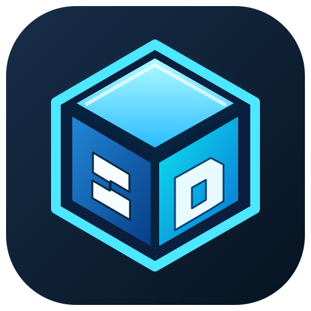

# 3D-Maker

**Ein lokaler 3D-Modellierer für Windows und den Browser.** Entwerfe und bearbeite 3D-Objekte in einer übersichtlichen Arbeitsfläche – ohne Benutzerkonto, Cloudzwang, Werbung oder Slicer.

[](https://github.com/Inrouder/3D-Maker/actions/workflows/build.yml)


> **Entwicklungsstatus:** 3D-Maker befindet sich in aktiver Entwicklung. Vor produktivem Einsatz, besonders bei Passungen, Gewinden oder sicherheitsrelevanten Teilen, Geometrien und exportierte STLs überprüfen.

## Auf einen Blick

| Modellierung | Projekte & Dateien | Oberfläche |
| --- | --- | --- |
| Quader, Kugeln, Zylinder, Kegel | STL-/OBJ-Import | Interaktive 3D-Arbeitsfläche |
| 3D-Text, Zahnräder, Gewinde | STL-Export | Objekt-Explorer |
| Boolescher Ausschnitt (H) | Projektdateien als JSON | Hell-/Dunkelmodus |
| Ebenenschnitt und Teilen | Lokale Speicherung | Deutsch / Englisch |
| Gruppieren, Duplizieren | Rückgängig / Wiederholen | Präzise mm-Eingaben |

### Typischer Ablauf

1. **Körper erstellen:** Quader, Zylinder oder eine parametrisierte Form einfügen.
2. **Bearbeiten:** Mit den Griffen verschieben, drehen oder skalieren; numerische Maße in Millimetern festlegen.
3. **Kombinieren:** Ein Werkstück und einen Schneidkörper auswählen, dann mit **H** den Ausschnitt durchführen.
4. **Speichern:** Projekt lokal sichern oder Modelle als STL exportieren.

## Design und Programm-Icon



Das neue 3D-Würfel-Icon wird als SVG im Browser und als mehrstufiges Windows-ICO in der portablen EXE verwendet. Die Icon-Dateien werden beim Windows-Build automatisch erzeugt (`npm run icon:generate`).

## Windows: portable EXE herunterladen

**Empfohlener Einstieg:** [GitHub Releases](https://github.com/Inrouder/3D-Maker/releases/latest)

1. Die neueste veröffentlichte Version öffnen.
2. `3D-Maker-Portable-<version>.exe` herunterladen.
3. Die EXE starten. Es ist keine klassische Installation und kein separates Node.js erforderlich.

Wenn noch kein GitHub Release existiert: [Actions / Build 3DMaker](https://github.com/Inrouder/3D-Maker/actions/workflows/build.yml) öffnen, einen erfolgreichen Build auswählen und unter **Artifacts** `3DMaker-Portable-Windows-x64` laden. Artefakte sind zeitlich begrenzt und gelten nicht als veröffentlichte Updates.

### Integrierte Updateprüfung

Die Windows-Version prüft beim Start sowie alle sechs Stunden auf neue **GitHub Releases**. Eine neue Version wird in den Einstellungen angezeigt, inklusive Versionsnummer und Versionshinweisen. Unter **Einstellungen → Programm-Updates** lässt sich die Prüfung auch manuell starten.

- Updates werden **nicht** heimlich installiert: `Update herunterladen` öffnet die Release-Seite im Standardbrowser. Vor dem Wechsel die Arbeit speichern, alte EXE schließen und neue EXE starten.
- **Öffentliches Repository:** Die Updateprüfung verwendet die öffentliche GitHub-Releases-API. Es ist **kein Login und kein Token** erforderlich. GitHub kann bei sehr häufigen Abfragen API-Limits anwenden.
- Ohne erreichbaren Release oder GitHub-Zugriff erscheint eine klare Statusmeldung. Für die Browser-Version steht die Electron-Updatefunktion nicht zur Verfügung.
- Die Versionsnummer eines Release-Tags (`v0.1.8` usw.) muss zur App-Version in `package.json` passen.

## Tastenkürzel

| Kürzel | Aktion |
| --- | --- |
| `H` | Ausschnitt: zuerst Zielobjekt, dann Schneidkörper auswählen |
| `C` | Schnittebene aktivieren/deaktivieren |
| `Strg+S` | Projekt speichern |
| `Entf` | Auswahl löschen |
| `Esc` | Auswahl aufheben |
| `Umschalt+Klick` | Mehrere Objekte auswählen |

## Selbst bauen

Node.js 22 und npm werden für die Entwicklung benötigt.

```bash
npm install
npm run dev
```

Web-Produktionsversion:

```bash
npm run build
npm run preview
```

Portable Windows-EXE (unter Windows):

```bash
npm run dist:portable
```

Der GitHub-Actions-Workflow baut bei Änderungen am Standardbranch eine Web-Version und eine portable Windows-EXE. Wird ein Tag wie `v0.1.8` gepusht, erstellt der Workflow zusätzlich einen GitHub Release mit der EXE. **Die Release-Erstellung setzt die nötigen Actions-Schreibrechte voraus.** Ohne veröffentlichten Release kann die Updateprüfung keine neue Version melden.

## Technologie

React 19 · TypeScript · Three.js · Vite · Electron · electron-builder · GitHub Actions.

3D-Maker speichert Projekte lokal und benötigt für die eigentliche Modellierung keine Netzwerkverbindung. Eine Verbindung zu GitHub wird ausschließlich für optionale Updateprüfungen oder das manuelle Öffnen des Repositorys verwendet.

## Projekt & Mitwirkung

- [Entwicklungsplan](docs/ROADMAP.md)
- [Fehler melden / Vorschlag einreichen](https://github.com/Inrouder/3D-Maker/issues)
- [Quellcode](https://github.com/Inrouder/3D-Maker)

**Projekt:** Shad3pi · 3D-Maker. Eine eigenständige Entwicklung; XYZmaker diente als funktionale Inspiration. Es wird kein proprietärer Code des ursprünglichen Programms verwendet.

**Lizenz:** Eine Projektlizenz ist noch nicht festgelegt. Öffentlich sichtbarer Quellcode ist nicht automatisch Open Source; vor externer Weiterverwendung die Lizenzfrage klären.
